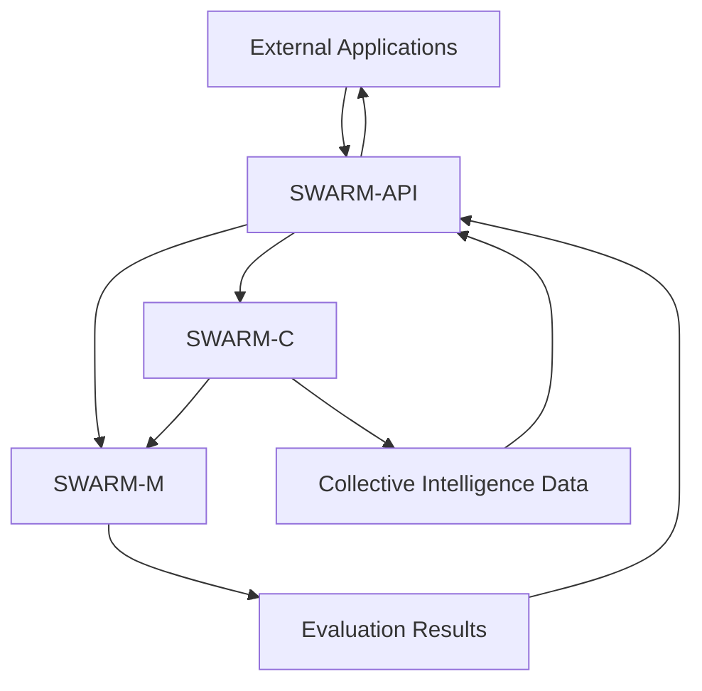
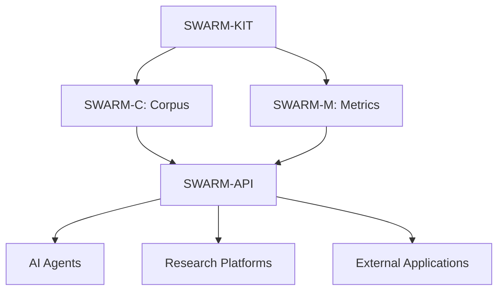

# SWARM-API
### Swarm Knowledge & Evaluation Toolkit — Application Programming Interface

**SWARM-API** is the programmatic interface of the SWARM-KIT ecosystem. It provides unified access to the SWARM-C corpus and SWARM-M metrics, enabling applications, researchers and autonomous agents to retrieve collective intelligence episodes, submit new data, evaluate swarm behaviour and compare experimental results.

## 1. Overview

The SWARM-API connects the main components of the SWARM-KIT:

- **SWARM-C:** A structured corpus of collective intelligence episodes, including agents, interactions, communication protocols, reasoning processes, decisions, outcomes and experimental scenarios.
- **SWARM-M:** A collection of metrics designed to characterise and evaluate swarm systems and collective intelligence.
- **SWARM-API:** A RESTful interface providing programmatic access to the corpus and metrics.

### Architecture



## 2. Main Features

- Retrieve and search collective intelligence episodes.
- Register new swarm episodes.
- Access agent profiles and interaction records.
- Retrieve communication protocols and reasoning traces.
- Access collective decisions and experimental outcomes.
- Retrieve available SWARM-M metrics.
- Execute metrics on individual episodes or collections of episodes.
- Compare different swarm configurations.
- Export corpus data and evaluation results.
- Integrate external AI agents, multi-agent systems and research platforms.

## 3. API Base URL

The proposed API base URL is:

```text
https://api.swarm-kit.org/v1
```

For local development:

```text
http://localhost:8000/v1
```

All API requests and responses use JSON unless otherwise specified.

## 4. API Endpoints

### 4.1 General

| Method | Endpoint | Description |
|---|---|---|
| GET | `/` | API information |
| GET | `/health` | Service health check |
| GET | `/version` | API version |
| GET | `/documentation` | API documentation |

### 4.2 SWARM-C — Corpus

#### Episodes

| Method | Endpoint | Description |
|---|---|---|
| GET | `/corpus/episodes` | Retrieve episodes |
| GET | `/corpus/episodes/{episode_id}` | Retrieve a specific episode |
| POST | `/corpus/episodes` | Submit a new episode |
| PUT | `/corpus/episodes/{episode_id}` | Update an episode |
| DELETE | `/corpus/episodes/{episode_id}` | Delete an episode |

#### Agents

| Method | Endpoint | Description |
|---|---|---|
| GET | `/corpus/agents` | Retrieve agents |
| GET | `/corpus/agents/{agent_id}` | Retrieve an agent |
| GET | `/corpus/agents/{agent_id}/episodes` | Retrieve episodes involving an agent |

#### Interactions

| Method | Endpoint | Description |
|---|---|---|
| GET | `/corpus/episodes/{episode_id}/interactions` | Retrieve interactions |
| GET | `/corpus/episodes/{episode_id}/decisions` | Retrieve collective decisions |
| GET | `/corpus/episodes/{episode_id}/outcomes` | Retrieve outcomes |

### 4.3 SWARM-M — Metrics

#### Metric Catalogue

| Method | Endpoint | Description |
|---|---|---|
| GET | `/metrics` | List available metrics |
| GET | `/metrics/{metric_id}` | Retrieve metric definition |
| GET | `/metrics/categories` | Retrieve metric categories |

#### Metric Execution

| Method | Endpoint | Description |
|---|---|---|
| POST | `/metrics/evaluate` | Evaluate an episode |
| POST | `/metrics/evaluate/batch` | Evaluate multiple episodes |
| POST | `/metrics/compare` | Compare swarm configurations |
| GET | `/metrics/results/{result_id}` | Retrieve evaluation results |

### 4.4 SWARM-KIT — Integration

| Method | Endpoint | Description |
|---|---|---|
| GET | `/statistics` | Retrieve corpus statistics |
| GET | `/search` | Search the corpus |
| GET | `/exports/episodes/{episode_id}` | Export an episode |
| GET | `/exports/results/{result_id}` | Export evaluation results |

## 5. Data Structures

### 5.1 Collective Intelligence Episode

An episode represents a collective problem-solving process involving multiple agents.

Example:

```json
{
  "episode_id": "CIE-000001",
  "title": "Collaborative Route Optimisation",
  "scenario": {
    "type": "collaborative_problem_solving",
    "description": "Optimisation of delivery routes"
  },
  "agents": [
    {
      "agent_id": "A1",
      "role": "traffic_analysis",
      "type": "artificial"
    },
    {
      "agent_id": "A2",
      "role": "cost_optimisation",
      "type": "artificial"
    },
    {
      "agent_id": "A3",
      "role": "route_planning",
      "type": "artificial"
    }
  ],
  "interactions": [],
  "communication_protocol": {},
  "reasoning": [],
  "decisions": [],
  "outcomes": [],
  "evaluation": {},
  "metadata": {
    "source": "SWARM-C",
    "version": "1.0"
  }
}
```

### 5.2 Metric Definition

Each SWARM-M metric should have a standard definition.

```json
{
  "metric_id": "SWM-001",
  "name": "Communication Efficiency",
  "category": "interaction",
  "description": "Measures communication efficiency among agents",
  "formula": null,
  "input_requirements": [
    "interactions",
    "agents",
    "timestamps"
  ],
  "output_type": "numeric",
  "scale": "metric_specific"
}
```

### 5.3 Evaluation Result

```json
{
  "result_id": "RES-000001",
  "episode_id": "CIE-000001",
  "metrics": {
    "communication_efficiency": null,
    "coordination": null,
    "collective_performance": null
  },
  "evaluation_timestamp": null,
  "metric_version": "1.0"
}
```

The `null` values are placeholders and must be populated by the metric execution process.

## 6. Example API Usage

### Retrieve episodes

```http
GET /v1/corpus/episodes
```

### Retrieve a specific episode

```http
GET /v1/corpus/episodes/CIE-000001
```

### Submit a new episode

```http
POST /v1/corpus/episodes
Content-Type: application/json
```

The request body contains a valid Collective Intelligence Episode.

### Retrieve available metrics

```http
GET /v1/metrics
```

### Evaluate an episode

```http
POST /v1/metrics/evaluate
Content-Type: application/json
```

Request:

```json
{
  "episode_id": "CIE-000001",
  "metrics": [
    "communication_efficiency",
    "coordination",
    "collective_performance"
  ]
}
```

Response:

```json
{
  "result_id": "RES-000001",
  "episode_id": "CIE-000001",
  "status": "completed",
  "results": {}
}
```

### Compare two episodes

```http
POST /v1/metrics/compare
Content-Type: application/json
```

Request:

```json
{
  "episode_ids": [
    "CIE-000001",
    "CIE-000002"
  ],
  "metrics": [
    "coordination",
    "collective_performance"
  ]
}
```

## 7. HTTP Status Codes

| Code | Meaning |
|---|---|
| 200 | Request successful |
| 201 | Resource created |
| 202 | Evaluation accepted for asynchronous processing |
| 400 | Invalid request |
| 401 | Authentication required |
| 403 | Insufficient permissions |
| 404 | Resource not found |
| 409 | Resource conflict |
| 422 | Validation error |
| 500 | Internal server error |
| 503 | Service unavailable |

## 8. Technical Architecture

The initial implementation is proposed using:

| Component | Technology |
|---|---|
| API framework | Python / FastAPI |
| Data format | JSON |
| Data validation | Pydantic |
| Database | MongoDB or PostgreSQL |
| Metric engine | Python |
| API documentation | OpenAPI / Swagger |
| Containerisation | Docker |
| Testing | Pytest |

The architecture should separate the API layer, corpus storage and metric execution engine.

## 9. Security and Data Governance

The API should support:

- Authentication and authorisation.
- API key management.
- Input validation.
- Access control for corpus operations.
- Dataset provenance and licensing information.
- Version control for episodes and metrics.
- Logging and audit trails.

Public datasets and restricted experimental data should be managed according to their respective licences and access conditions.

## 10. Project Structure

Suggested repository structure:

```text
SWARM-API/
│
├── app/
│   ├── main.py
│   ├── config.py
│   │
│   ├── api/
│   │   └── v1/
│   │       ├── corpus.py
│   │       ├── agents.py
│   │       ├── interactions.py
│   │       ├── metrics.py
│   │       └── statistics.py
│   │
│   ├── schemas/
│   │   ├── episode.py
│   │   ├── agent.py
│   │   ├── interaction.py
│   │   └── metric.py
│   │
│   ├── services/
│   │   ├── corpus_service.py
│   │   └── metrics_service.py
│   │
│   └── database/
│       └── connection.py
│
├── tests/
│   ├── test_corpus.py
│   ├── test_metrics.py
│   └── test_api.py
│
├── docs/
│   └── architecture.md
│
├── examples/
│   ├── submit_episode.json
│   └── evaluate_episode.json
│
├── requirements.txt
├── Dockerfile
├── .env.example
├── LICENSE
└── README.md
```

## 11. Installation and Execution

### Requirements

- Python 3.11 or later.
- pip.
- Access to the selected SWARM-C storage backend.

### Installation

```bash
git clone https://github.com/SWARM-KIT/SWARM-API.git

cd SWARM-API

python -m venv venv

# Linux / macOS
source venv/bin/activate

# Windows
venv\Scripts\activate

pip install -r requirements.txt
```

### Run the API

```bash
uvicorn app.main:app --reload --port 8000
```

### Access the documentation

```text
http://localhost:8000/docs
```

The commands above describe the proposed implementation and will become executable once the corresponding source code and dependencies are created.

## 12. Integration with SWARM-KIT

SWARM-API is designed to act as the common access layer for the SWARM-KIT ecosystem.



The API allows external systems to access collective intelligence data and evaluate swarm behaviour using a common interface.

## 13. Development Roadmap

| Version | Planned functionality |
|---|---|
| 0.1.0 | Initial REST API and corpus retrieval |
| 0.2.0 | Episode submission and validation |
| 0.3.0 | SWARM-M integration |
| 0.4.0 | Batch evaluation and comparison |
| 0.5.0 | Search, filtering and data export |
| 1.0.0 | Stable API, documentation and benchmark integration |

## 14. Related Projects

- **SWARM-C:** Swarm Knowledge Corpus — structured collective intelligence data.
- **SWARM-M:** Swarm Metrics — metrics for swarm characterisation and evaluation.
- **SWARM-API:** Application Programming Interface — unified access to SWARM-C and SWARM-M.

## 15. Vision

SWARM-API aims to facilitate research and development in collective intelligence by providing a common programmatic interface for accessing, analysing and evaluating interactions and behaviours among autonomous agents.

It is a technological component of SWARM-KIT, an initiative towards understanding and advancing collective intelligence.

---

**SWARM-KIT — Towards a Wisdom Society.**
